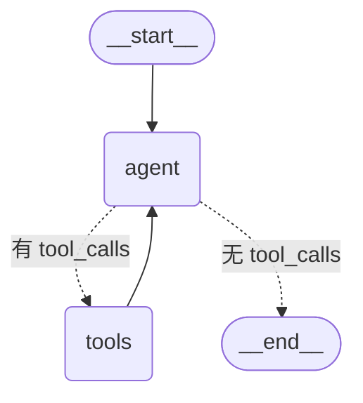

# 代码审查 Agent（LangGraph 版）

> 课程作业提交 · 学号 2412190209 · 王宝硕

基于 **LangGraph** 构建的代码审查 Agent。给它一个文件路径，它会自主调用工具读取代码、
做 AST 静态分析、在受限环境里运行验证，最后输出一份结构化的中文审查报告。

```text
你 › 帮我审查 examples/sample_buggy_code.py
🔧 调用 file_reader({"file_path": "examples/sample_buggy_code.py"})
🔧 调用 ast_analyzer({"code": "import sqlite3..."})
🔧 调用 code_executor({"code": "def average(values): ..."})
↩︎  file_reader 返回 1111 字符
↩︎  code_executor 返回 151 字符
┌──────────────── 审查结果 ────────────────┐
│ 📋 代码审查报告                          │
│ 🔴 严重问题：average() 循环越界…          │
│ 🔴 严重问题：SQL 注入…                    │
└──────────────────────────────────────────┘
```

---

## ✨ 功能特性

| 特性 | 说明 |
|---|---|
| **ReAct 工具闭环** | LLM 自主决定调用哪个工具，工具结果回填后继续推理，直到给出结论 |
| **三个内置工具** | `file_reader` 读文件、`ast_analyzer` 静态分析、`code_executor` 运行验证 |
| **流式过程可见** | 实时回显「调用了哪个工具、参数是什么、返回多少字符」，不再是黑盒等待 |
| **会话记忆** | 使用 LangGraph `MemorySaver` + `thread_id`，由框架托管多轮上下文 |
| **上下文裁剪** | 历史消息按上限裁剪，且从用户消息处对齐，绝不产生孤儿工具消息 |
| **三层安全边界** | 目录白名单 + 敏感文件拦截 + 代码执行 AST 策略校验 |
| **迭代保护** | `recursion_limit` 兜住工具死循环，并转成友好的中文提示 |
| **55 项单元测试** | 纯标准库 `unittest`，无需 API Key、不联网即可全部跑通 |

---

## 📁 项目结构

```text
agent-homework/
├── agent/
│   ├── __init__.py        # 包导出
│   ├── graph.py           # ⭐ LangGraph 图定义（节点、条件边、记忆、裁剪）
│   └── prompt.py          # 系统提示词（与编排逻辑解耦）
├── tools/
│   ├── __init__.py        # 工具注册（模块级构建一次）
│   ├── file_reader.py     # 读文件：目录白名单 + 敏感文件拦截
│   ├── ast_analyzer.py    # 静态分析：结构、圈复杂度、常见问题
│   ├── code_executor.py   # 受限执行：临时目录 + 裁剪环境变量 + 杀进程树
│   └── sandbox_policy.py  # 执行前的 AST 策略校验
├── examples/
│   └── sample_buggy_code.py  # 演示用样例（故意埋了 6 个典型问题）
├── tests/                 # 55 项单元测试
├── config.py              # ⭐ 集中配置：所有参数与安全边界
├── cli.py                 # 命令行入口
├── requirements.txt       # 运行依赖（带上界）
├── pyproject.toml         # 项目元数据 + pytest / ruff 配置
├── .env.example           # 配置模板（只有占位符）
└── Design.md              # 设计文档
```

代码量：源码 **895 行**、测试 **395 行**（`tests/` 5 个文件、55 个用例）。

---

## 🚀 快速开始

### 1. 环境要求

- **Python ≥ 3.10**（LangGraph 1.x 的最低要求）
- 已在 `Python 3.14.0` + 下列版本上实测通过：

```text
langgraph 1.2.12 · langchain-core 1.6.6 · langchain-openai 1.6.7
python-dotenv 1.2.4 · rich 15.0.0
```

### 2. 安装依赖

```bash
pip install -r requirements.txt
```

### 3. 配置密钥

```bash
# Windows
copy .env.example .env
# macOS / Linux
cp .env.example .env
```

然后编辑 `.env`，填入你自己的 Key：

```ini
LLM_API_KEY=your-api-key-here
LLM_BASE_URL=https://api.deepseek.com/v1
LLM_MODEL=deepseek-chat
```

> ⚠️ `.env` 已被 `.gitignore` 排除，**请勿把真实密钥写进 `.env.example` 或提交到仓库**。

### 4. 运行

```bash
python cli.py
```

---

## 🖥️ 使用方法

### 命令行参数

```bash
python cli.py                            # 只允许访问当前工作目录
python cli.py --root D:\code             # 额外放开一个目录（可重复指定）
python cli.py --no-memory                # 关闭会话记忆，每轮无状态
python cli.py --graph agent_graph.mmd    # 离线导出图结构（不需要 API Key）
```

### 交互命令

| 输入 | 作用 |
|---|---|
| 任意自然语言 | 交给 Agent 处理 |
| `clear` | 清空当前会话（内部切换新的 `thread_id`） |
| `quit` / `exit` / `q` | 退出 |

### 示例对话

```text
你 › 审查 examples/sample_buggy_code.py，先用静态分析，再运行验证 average()
你 › 刚才那个 SQL 注入问题，给出参数化写法的完整修复代码
你 › clear
```

---

## 🧠 图结构

`python cli.py --graph` 可以离线导出下面这张图（Mermaid 文本）：



- **节点**：`agent` 调 LLM；`tools` 是 LangGraph 内置的 `ToolNode`，自动并行执行工具调用
- **状态**：使用内置 `MessagesState`，整张图共享同一份消息列表
- **条件边**：`should_continue` 检查最后一条消息是否带 `tool_calls`，决定继续调工具还是收尾

---

## 🔐 安全设计（重要）

Agent 会读本机文件、会执行代码，因此必须画出明确的边界。

| 防线 | 实现位置 | 作用 |
|---|---|---|
| **目录白名单** | `config.is_path_allowed` + `file_reader` | 默认只允许读当前工作目录；`resolve()` 后比较，软链接逃逸同样会被拦下 |
| **敏感文件拦截** | `config.DENIED_FILE_NAMES / SUFFIXES` | 无论是否在白名单内，`.env`、`id_rsa`、`*.pem`、`*.key` 一律拒读，防止密钥被送进远端模型 |
| **执行目录隔离** | `code_executor` | 每次执行都在全新的系统临时目录，`cwd` 不指向项目，被执行的代码看不到项目文件 |
| **环境变量裁剪** | `code_executor.build_child_env` | 只透传系统变量，`LLM_API_KEY` 等密钥不会进入子进程 |
| **AST 策略校验** | `tools/sandbox_policy.py` | 拦截 `import os`、`__import__`、`eval/exec/open/getattr`、双下划线属性穿透；基于语法树而非字符串匹配，不会因为注释里出现 `os.system` 就误杀 |
| **进程树回收** | `code_executor.kill_process_tree` | 超时后 Windows 用 `taskkill /T`、POSIX 用进程组 kill，不留残留进程 |

> ❗**必须说明的边界**：`sandbox_policy` 是一道**策略检查**，不是操作系统级的沙箱。
> 它足以拦住 LLM 常见的越权写法，但**不能用来执行真正恶意的代码**。
> 若要执行完全不可信的代码，请上容器 / 虚拟机 / 低权限用户。

---

## 🧪 测试

测试全部使用标准库 `unittest`，**不需要 API Key，也不会发起任何网络请求**
（图相关的用例用脚本化的假模型替换真实 LLM）。

```bash
# 方式一：标准库
python -m unittest discover -s tests -t . -v

# 方式二：装了 pytest 也可以
pytest -q
```

实测结果：

```text
Ran 55 tests in 2.53s

OK
```

覆盖范围：

| 测试文件 | 用例数 | 覆盖内容 |
|---|---|---|
| `tests/test_sandbox_policy.py` | 12 | 导入白名单、危险调用拦截、双下划线穿透、误杀回归 |
| `tests/test_ast_analyzer.py` | 8 | 语法错误、结构与复杂度统计、可变默认参数、裸 except |
| `tests/test_file_reader.py` | 10 | 白名单越界、敏感文件、编码、超大文件、截断 |
| `tests/test_code_executor.py` | 8 | 正常执行、拒绝执行、异常输出、超时杀进程、输出截断、环境变量不泄漏 |
| `tests/test_graph.py` | 17 | 条件边、历史裁剪、图结构、工具闭环、迭代上限、记忆跨轮保持 |

---

## ⚙️ 配置项

全部集中在 `config.py`，都可以用环境变量或 `.env` 覆盖。

| 变量 | 默认值 | 说明 |
|---|---|---|
| `LLM_API_KEY` | 无（必填） | 模型密钥 |
| `LLM_BASE_URL` | OpenAI 官方 | 兼容接口地址 |
| `LLM_MODEL` | `gpt-4o-mini` | 模型名 |
| `LLM_TEMPERATURE` | `0.3` | 生成随机性 |
| `LLM_REQUEST_TIMEOUT` | `60` | 单次请求超时（秒） |
| `LLM_MAX_RETRIES` | `2` | 请求失败自动重试次数 |
| `ALLOWED_ROOTS` | 当前工作目录 | `file_reader` 可读目录，多个用 `;`（Windows）分隔 |
| `MAX_FILE_BYTES` | `1048576` | 单文件体积上限（1MB） |
| `MAX_FILE_CHARS` | `20000` | 读取内容字符上限，超出截断 |
| `EXEC_TIMEOUT_SECONDS` | `10` | 代码执行超时（秒） |
| `EXEC_MAX_OUTPUT_CHARS` | `5000` | 执行输出字符上限 |
| `AGENT_RECURSION_LIMIT` | `25` | 单轮最大图步数，防死循环 |
| `AGENT_MAX_HISTORY_MESSAGES` | `40` | 送入模型的历史消息上限 |
| `AGENT_ENABLE_CHECKPOINTER` | `1` | 是否启用会话记忆 |

---

## 📊 与手写版的对比

| 对比项 | 手写版 | LangGraph 版 |
|---|---|---|
| Agent 循环 | 自己写 `while` 循环 | 由图的边与条件边表达 |
| 工具调用解析 | 自己解析 `tool_calls` JSON | 框架 + `ToolNode` |
| 工具定义 | 手写 schema JSON | `@tool` 装饰器 |
| 对话记忆 | 自己维护消息列表 | `MemorySaver` + `thread_id` |
| 消息格式 | 自己拼 OpenAI 格式 | `MessagesState` 统一管理 |
| 结构可视化 | 需要自己画图 | `--graph` 一键导出 Mermaid |

> 说明：本表只描述**机制差异**，不代表 LangGraph 版在所有方面都更好。
> 例如错误重试仍需要自己配置 `max_retries`，LangGraph 并不会自动帮你做请求级重试。

---

## ⚠️ 已知限制

1. **不是真正的沙箱**：见上文安全设计说明，切勿执行来路不明的代码。
2. **会话记忆只存在内存**：`MemorySaver` 进程退出即丢失；多进程/重启后无法恢复。
3. **只能审查单文件**：暂不支持整目录、多文件或 diff / PR 级别的审查。
4. **Windows 优先**：进程树回收、路径分隔符等按 Windows 语义调优，Linux/macOS 走的是 `killpg` 分支，未做长期验证。
5. **报告仍是自然语言**：没有结构化的 `findings` 字段，无法直接对接 CI 做门禁。

后续演进方向见 `Design.md` 第 9 节。
